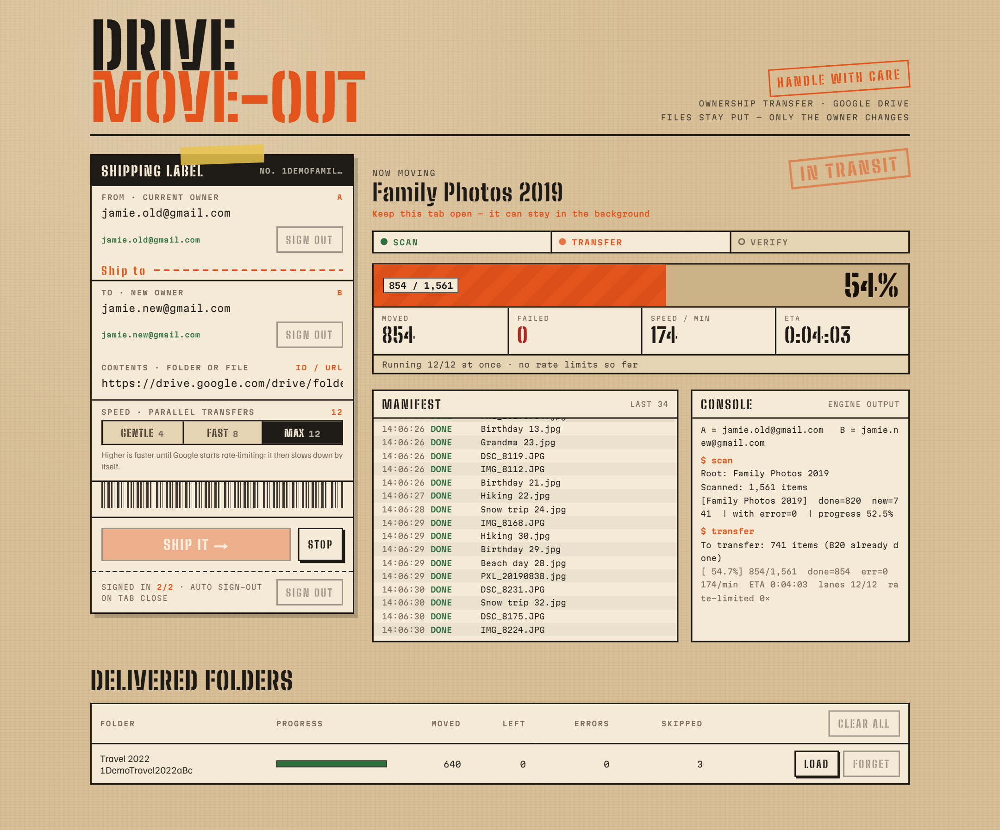

# Drive Move-Out: transfer ownership of a Google Drive folder to another account

**Bulk-transfer ownership of a Google Drive folder, including every file and subfolder inside it, from one Gmail account to another.** No downloading, no re-uploading: the files stay where they are and only the owner changes, so they move to the new account's storage quota.

**[Live demo → google-move-out.quangthn.net](https://google-move-out.quangthn.net)**

<picture>
  <source media="(prefers-color-scheme: dark)" srcset="docs/screenshot-dark.png">
  
</picture>

## Why

Google Drive lets one personal account transfer ownership to another, but only **one item at a time**, and transferring a folder **does not transfer the files inside it**. Moving a folder with thousands of photos to a new account by hand means thousands of manual transfers, or downloading everything and uploading it again.

Drive Move-Out walks the whole folder tree and transfers every item for you. Sharing settings, links and comments are kept.

Typical uses:

- moving photos or documents from an old Gmail account to a new one
- freeing up storage on a full account by moving files to another account's quota
- handing a shared project folder over to someone else
- consolidating two personal Google accounts

## How it works

For every file and folder owned by the current owner (account **A**):

1. A invites B as a *pending owner* (`permissions.create` with `pendingOwner: true`, no email is sent).
2. B accepts the ownership (`permissions.update` with `role: owner`, `transferOwnership: true`).

Both accounts sign in to the same browser tab, so both steps happen automatically. Items A does not own (shortcuts, files shared with A by other people) are skipped and left alone. Files that already belong to B are counted as done.

Other details:

- **Resumable.** Progress is saved after every file. Stop, reload (F5) or come back later; shipping the same folder again continues where it left off.
- **Fast, but polite.** Run 4, 8 or 12 transfers at once. When Google rate-limits, the app halves its parallelism and slowly speeds up again.
- **Runs in the background.** The engine lives in a Web Worker, so the tab can stay in the background while it works. It has to stay open.

## Privacy

- **Your files never pass through the server.** The browser talks to the Google Drive API directly.
- **The server keeps nothing.** Its only job is a small route (`/api/oauth`) that holds the OAuth client secret and swaps sign-in codes and refresh tokens with Google. It stores no data and has no database.
- **Sign-in lives only in the tab.** Tokens are kept in the tab's `sessionStorage`. Closing the tab signs both accounts out and revokes the access at Google.
- **On your device**, the browser remembers the two email addresses (`localStorage`) and the transfer progress (IndexedDB) so a stopped folder can resume. *Forget* / *Clear all* in the app, or clearing the site's data in the browser, removes it.

## Limitations

- **Personal (consumer) Google accounts only.** Google Workspace accounts transfer ownership differently (within the same organisation, through the admin console), and that is not supported here.
- **Full Drive access.** The app needs the `https://www.googleapis.com/auth/drive` scope, which Google classifies as *restricted*. Publishing an app with this scope for the general public requires Google's OAuth verification and a yearly security assessment. For yourself, family or friends, keep the OAuth app in **Testing** mode and add each Google account as a test user (up to 100). Users will see a "Google hasn't verified this app" warning that they can continue past.
- **Google's sharing limits apply per account.** Very large folders may hit `sharingRateLimitExceeded`; the app then waits and retries automatically.
- **Re-consent screen.** If an account granted access before and the tab was closed without signing out, Google's re-consent screen can hang on *Continue*. Remove the app's access at [myaccount.google.com/connections](https://myaccount.google.com/connections) and sign in again.

## Run it yourself

You need Node.js 20+ and a Google Cloud project.

### 1. Google Cloud setup

1. Create (or pick) a project in the [Google Cloud Console](https://console.cloud.google.com/).
2. **APIs & Services → Library**: enable the **Google Drive API**.
3. **APIs & Services → OAuth consent screen**: choose *External*, keep the publishing status on **Testing**, and add the Google accounts that will use the app as **test users**.
4. **APIs & Services → Credentials → Create credentials → OAuth client ID**, application type **Web application**, with these **Authorized redirect URIs** (exactly, without a trailing slash):
   - `http://localhost:3000/callback` for local development
   - `https://<your-domain>/callback` for your deployment
5. Copy the client ID and client secret.

### 2. Local development

```bash
git clone https://github.com/thaihuynhatquang/google-drive-move-out.git
cd google-drive-move-out
npm install
cp .env.example .env.local   # then fill in GOOGLE_CLIENT_ID and GOOGLE_CLIENT_SECRET
npm run dev                  # http://localhost:3000
```

### 3. Deploy

The repo includes a `netlify.toml`: import it on [Netlify](https://www.netlify.com/), which detects Next.js automatically. Then:

1. Set `GOOGLE_CLIENT_ID` and `GOOGLE_CLIENT_SECRET` under **Site configuration → Environment variables**.
2. Add `https://<your-site>/callback` to the OAuth client's redirect URIs.

Any host that runs a Next.js server works the same way, Vercel included.

| Variable | Required | Description |
| --- | --- | --- |
| `GOOGLE_CLIENT_ID` | yes | OAuth client ID (Web application) |
| `GOOGLE_CLIENT_SECRET` | yes | OAuth client secret; only used server-side by `/api/oauth` |
| `ALLOWED_ORIGINS` | no | Extra comma-separated origins allowed to call `/api/oauth`. The site's own origin is always allowed. |

## Using it

1. Enter the current owner's and the new owner's email addresses and press **Sign in with Google** under each. The tab goes to Google and comes back.
2. Paste the link (or ID) of the folder or file, from the current owner's Drive.
3. Pick a speed and press **Ship it**. The app scans the tree, transfers every item, then spot-checks the result as the new owner.
4. When it is done, ship another folder, or press **Sign out** before closing the tab.

## Project structure

```
app/
  page.tsx, move-out.tsx   UI (client component)
  callback/page.tsx        OAuth redirect target: finishes sign-in, returns to /
  api/oauth/route.ts       the only server code: token exchange / refresh / revoke
lib/
  auth.ts                  sign-in by redirect + PKCE, tokens in sessionStorage
  drive.ts                 small Drive v3 client with retries and back-off
  transfer.worker.ts       scan → transfer → verify engine (Web Worker + IndexedDB)
  types.ts                 messages between the page and the worker
```

Built with Next.js 16, React 19 and TypeScript, with no other runtime dependencies.

## FAQ

**How do I transfer ownership of a Google Drive folder to another Gmail account?**
In Drive's sharing dialog you can make someone else the owner, but only for one item at a time, and the folder's contents are not included. To transfer the folder and everything in it, sign both accounts in to Drive Move-Out, paste the folder link and press *Ship it*.

**Can I move files to another Google account without downloading and re-uploading them?**
Yes. Transferring ownership changes who owns each file. Nothing is copied, so it is much faster than downloading and uploading again, and it doesn't use bandwidth or local disk.

**Does transferring ownership of a folder also transfer the files inside it?**
Not in Google Drive itself; every file and subfolder is a separate item with its own owner. That is exactly the gap this app fills.

**Will shared links, sharing settings or comments break?**
No. The items keep their IDs, links, sharing settings and comments. The previous owner keeps editor access until it is removed.

**Whose storage do the files count against after the transfer?**
The new owner's. That's why moving ownership frees up space on the old account.

**Does it work with Google Workspace (work or school) accounts?**
No, it's for personal Gmail accounts only. Workspace administrators can transfer a user's data from the Admin console instead.

**Is my data safe?**
Files go straight between your browser and Google; the server only exchanges sign-in codes and stores nothing. See [Privacy](#privacy).

**Is it free?**
Yes. The project is open source under the MIT license, and you can use the demo or host your own copy.

## Disclaimer

Transferring ownership is permanent unless the new owner transfers it back. Try the app on a small test folder first. This project is not affiliated with or endorsed by Google.

## License

[MIT](LICENSE)
